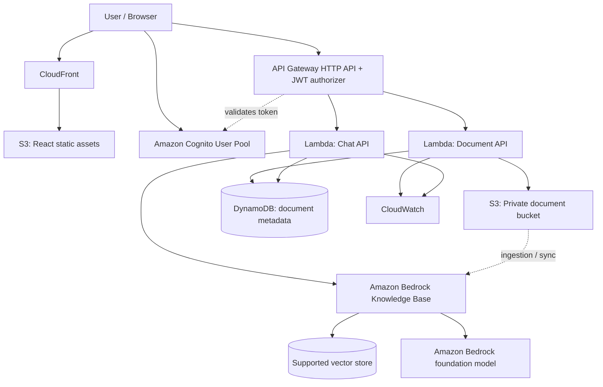

# Architecture

## 1. High-level architecture

The diagram is conceptual. Region: `ap-southeast-1`. Ingestion uses the Knowledge Base direct-ingestion API per document (D-006, verified in Phase 0). The vector store is S3 Vectors if supported (D-007). See `DECISIONS.md` D-010 for how this maps to the reference diagram.

## 2. Components and responsibilities

| Component | Responsibility |
|---|---|
| React + TypeScript | Upload UI, document list, chat interface, citations |
| S3 website bucket | Stores built frontend assets; private origin behind CloudFront is preferred |
| CloudFront | HTTPS delivery and caching of frontend assets |
| Amazon Cognito | User sign-in (admin-created users only); issues JWTs |
| API Gateway HTTP API | Public HTTPS API entry point; validates Cognito JWTs, throttles, routes to Lambda |
| Document Lambda | Creates presigned upload URLs, records metadata, initiates/checks ingestion |
| Chat Lambda | Validates questions and invokes Bedrock Knowledge Bases |
| Private S3 document bucket | Stores source documents; never expose public object access |
| DynamoDB | Stores document metadata and, optionally, chat history |
| Bedrock Knowledge Bases | Coordinates document ingestion, retrieval, and grounded generation |
| Embedding model | Converts document passages and queries into vector representations |
| Vector store | Stores/searches embeddings; choose a Bedrock-supported option available in the selected Region |
| Foundation model | Generates natural-language responses from retrieved context |
| CloudWatch | Logs, metrics, dashboards, and alarms |

## 3. Document upload and ingestion flow

1. Browser calls `POST /documents/upload-url` with filename, content type, and size.
2. Document Lambda validates the request and creates a document record with status `PENDING_UPLOAD`.
3. Lambda returns a short-lived presigned S3 PUT URL and a document ID.
4. Browser uploads directly to the private S3 bucket using that URL.
5. Browser calls `POST /documents/{documentId}/ingest` (or a verified S3-event-driven workflow invokes ingestion).
6. Backend checks that the object exists under the caller's prefix, then calls `IngestKnowledgeBaseDocuments` for that one S3 object with `userId` metadata (D-006).
7. Status is checked with `GetKnowledgeBaseDocuments` in a bounded, retry-safe way.
8. Mark the document `READY` only after ingestion is confirmed complete. Handle failures explicitly.

**Important:** `StartIngestionJob` syncs a whole data source; direct ingestion works per document. Do not run both at the same time. The data source needs one initial sync after creation. Deleting from the Knowledge Base does not delete the S3 object. If direct ingestion fails the Phase 0 spike, fall back to serialized sync jobs with a DynamoDB lock.

## 4. Question-answering flow

1. Browser sends `POST /chat`.
2. Chat Lambda validates the question and any conversation/document scope.
3. Lambda calls Bedrock Knowledge Bases `RetrieveAndGenerate` with the configured Knowledge Base and model identifiers and a metadata filter `userId = <caller sub>`.
4. Bedrock retrieves relevant chunks from the vector store and generates a response.
5. Lambda maps the answer and returned citations into the API response.
6. Browser renders the answer and source references.

Do not fabricate citations. Preserve the source metadata returned by Bedrock and show only fields that are actually available.

## 5. Future asynchronous architecture

After the MVP works, consider:
- S3 event notification -> SQS -> ingestion worker Lambda.
- Step Functions for multi-step ingestion, retries, and status transitions.
- Dead-letter queue for failed messages.
- Bedrock Guardrails for configurable content safeguards.

Do not introduce these services before the simpler workflow is understood and tested.

## 6. Region and service availability

Before deployment, verify in the chosen AWS Region:
- Amazon Bedrock availability.
- The selected foundation model and embedding model availability/access.
- Bedrock Knowledge Bases availability.
- Supported vector-store integrations and required permissions.
- Relevant quotas and pricing.

Do not hard-code a vector-store choice based only on a tutorial. Keep the vector-store decision documented and configurable.

## 7. Trust boundaries

- Browser is untrusted.
- User identity comes only from the verified Cognito JWT (`sub`), never from request bodies.
- Presigned URLs are bearer credentials: short expiry, narrow object key, one intended operation.
- S3 document bucket is private.
- Lambda roles have only required actions and resource scopes.
- Bedrock model and Knowledge Base identifiers are configuration, not secrets.
- Never send AWS credentials to the browser.
