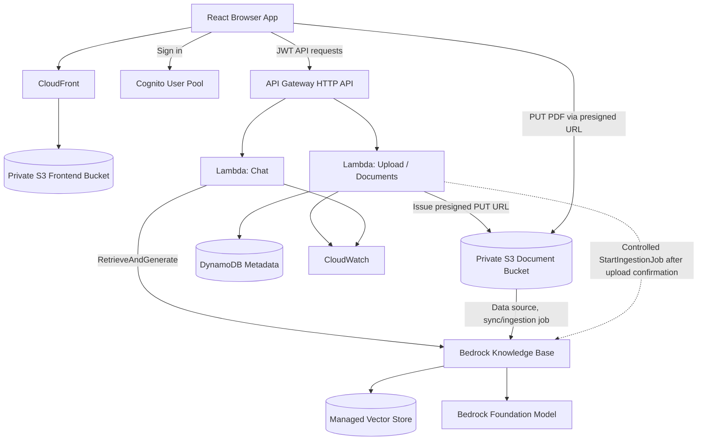

# CloudDocs AI — Project Specification & AI Coding Agent Handoff

**Status:** Ready to implement  
**Project type:** Portfolio-grade AWS cloud engineering + generative AI application  
**Primary goal:** Demonstrate production-minded AWS architecture, Infrastructure as Code, security, observability, CI/CD, and Retrieval-Augmented Generation (RAG).  
**Target roles:** Junior Cloud Engineer / DevOps Engineer / AWS-focused developer  
**Default language:** English in documentation, code, commits, and UI.

> **For the coding agent:** Treat this file as the source of truth for the intended product and architecture. First inspect the repository and report what exists. Implement in small, testable milestones. Do not deploy to AWS, provision billable resources, access real credentials, or delete existing resources without explicit user approval. If details are unspecified, choose the simplest secure and cost-conscious implementation and document the decision.

## 1. Product vision

Build **CloudDocs AI**, a serverless web application where an authenticated user can upload PDF documents, track indexing status, and ask natural-language questions about the documents. The application uses **Amazon Bedrock Knowledge Bases** for managed Retrieval-Augmented Generation (RAG), producing responses grounded in indexed documents and showing source citations.

This is **not** a generic LLM chat wrapper. The project must visibly demonstrate end-to-end cloud architecture, traceable AI retrieval, secure access to documents, and reliable deployment workflows.

### Main user story

1. A user signs in.
2. The user uploads a small PDF through the browser.
3. The browser transfers the file directly to a private S3 bucket via a short-lived presigned URL.
4. The application tracks the document's ingestion/indexing lifecycle.
5. After the document is indexed, the user asks a question.
6. The backend retrieves relevant document passages and generates a grounded answer using Bedrock.
7. The UI displays the answer and references to the supporting source documents.
8. The user can review their documents and remove a document from their workspace (including correct re-indexing/deletion behavior).

## 2. Goals and non-goals

### Goals

- Design a **secure, serverless AWS architecture** with explicit trust boundaries.
- Build and explain a **managed RAG pipeline** (ingestion, embeddings, vector retrieval, generation, citations).
- Implement the infrastructure with **Terraform** (preferred), not manual console-only deployment.
- Add reproducible local development, automated tests, and GitHub Actions CI.
- Use IAM least privilege, CloudWatch logs/metrics, error handling, and cost controls.
- Make AWS deployment optional and cleanly removable to minimize cost.
- Produce professional README, architecture diagrams, and a concise explanation of trade-offs for a portfolio/CV.

### Non-goals for MVP

- Training or fine-tuning a foundation model.
- Kubernetes, EKS, multi-region active-active, or complicated microservices.
- Organization-wide SaaS, billing, collaboration, or enterprise SSO.
- Custom vector database infrastructure if a suitable managed Bedrock Knowledge Base vector store is supported.
- Automatic support for arbitrary file formats; **PDF only** initially.
- A guarantee that generated answers are correct; users should see citations and appropriate uncertainty.

## 3. Preferred technology stack

| Layer | Preferred technology | Responsibility |
|---|---|---|
| Frontend | React + TypeScript + Vite | Document management and chat UI |
| Frontend hosting | Amazon S3 + CloudFront | Private static origin and HTTPS delivery |
| Authentication | Amazon Cognito User Pool | User authentication; JWTs for API authorization |
| API | Amazon API Gateway HTTP API | Authenticated HTTPS endpoints |
| Backend | Python 3.12+ on AWS Lambda | Upload authorization, document metadata, chat orchestration |
| Document storage | Amazon S3 | Private PDFs, separated by owner/workspace prefix |
| Metadata | Amazon DynamoDB | Document status, ownership, chat metadata as needed |
| Generative AI | Amazon Bedrock foundation model | Answer generation |
| RAG | Amazon Bedrock Knowledge Bases | Managed ingestion, embeddings, retrieval, citations |
| Vector storage | S3 Vectors **if supported by Knowledge Bases in chosen region** | Cost-conscious managed vector storage |
| Monitoring | Amazon CloudWatch | Structured logs, metrics, alarms |
| IaC | Terraform | Repeatable provisioning and teardown |
| CI | GitHub Actions | Lint, test, IaC validation; gated deploy later |
| Async extensions | SQS + Step Functions | Optional processing orchestration after MVP |

**Compatibility gate:** Before implementing AI infrastructure, check current AWS support in the selected region for Bedrock models, Knowledge Bases, embedding model, and S3 Vectors. Record tested region and model identifiers in docs. If S3 Vectors is unsupported, propose an alternative with a cost estimate and **request approval before provisioning**. Do not assume every AWS region supports every model or feature.

## 4. System architecture



**Important architectural distinction:** Uploading a file to S3 does **not** by itself guarantee that an Amazon Bedrock Knowledge Base will index it. Design an explicit ingestion strategy. For MVP, the backend should confirm upload completion, request a Knowledge Base ingestion/sync job, and poll/query job status to update document state; a small manual/admin sync fallback is acceptable for the first end-to-end demo. If a provider-managed incremental ingestion path is available, evaluate it explicitly rather than assuming behavior. In a shared data source, a sync job may process multiple changed objects; document status must not be marked `READY` merely because a sync was requested.

### Isolation warning

One shared knowledge base may retrieve content belonging to other users. **Authentication alone does not provide document-level RAG authorization.** For a multi-user implementation, design and test isolation with Bedrock retrieval metadata filters or separate per-user/workspace knowledge bases, including how indexed metadata is attached to sources. Never claim isolation is secure without an end-to-end authorization test. For the first milestone, a **single-owner private portfolio workspace** is acceptable if documented clearly and implemented with an authenticated account; disable public signup if appropriate.

## 5. Key workflows

### A. PDF upload

1. Authenticated browser sends filename, content type, and size to `POST /documents/upload-url`.
2. Lambda validates allowed type, maximum size, ownership, and a safe object key.
3. Lambda returns a short-lived **presigned S3 PUT URL** and document ID.
4. Browser uploads the PDF directly to the document bucket.
5. Browser calls `POST /documents/{id}/complete`.
6. Backend confirms the S3 object exists and checks actual size/type where feasible; do not trust client-declared metadata alone.
7. Backend records metadata (`UPLOADED`), starts or schedules an ingestion job, and exposes `INDEXING`/`READY`/`FAILED` status.
8. UI polls `GET /documents/{id}` or `GET /documents` until the status is resolved.

**MVP limits:** PDF only; maximum 10 MB/file; at most 5 uploaded files in initial demo; configurable limits. Do not accept file contents directly through API Gateway.

### B. RAG question answering

1. Browser sends the question to `POST /chat/query`.
2. Backend validates JWT context, request length, and workspace/document access rules.
3. Backend calls Bedrock Knowledge Bases `RetrieveAndGenerate` with the configured knowledge base and generation model, using retrieval filters when isolation requires them.
4. Backend normalizes the answer and source citations into an application-friendly response.
5. UI shows the answer, cited source document names, and relevant snippets/locations where returned.
6. For no relevant evidence, response should state uncertainty rather than inventing a citation.

### C. Deletion

1. Verify document ownership.
2. Remove document object from S3 and update metadata.
3. Trigger or schedule Knowledge Base resynchronization/deletion of indexed content.
4. Do not declare deletion complete from the AI index until verified; show `DELETING` where necessary.

## 6. API contract (proposed)

All endpoints except Cognito-hosted auth are authenticated.

| Method | Route | Purpose |
|---|---|---|
| `POST` | `/documents/upload-url` | Request presigned upload URL |
| `POST` | `/documents/{id}/complete` | Confirm upload and request indexing |
| `GET` | `/documents` | List current user's documents |
| `GET` | `/documents/{id}` | Retrieve metadata/indexing status |
| `DELETE` | `/documents/{id}` | Remove document and its indexed content |
| `POST` | `/chat/query` | Ask question; receive grounded answer + citations |
| `GET` | `/health` | Optional non-sensitive service health check |

Example request:

```json
{
  "question": "What are the key differences between SQS and SNS?"
}
```

Example response (illustrative; adapt to actual Bedrock output):

```json
{
  "answer": "SQS provides queue-based message buffering, while SNS provides pub/sub fanout...",
  "citations": [
    { "documentId": "doc_123", "documentName": "aws-notes.pdf", "excerpt": "..." }
  ],
  "requestId": "req_abc"
}
```

Use consistent structured errors with non-sensitive messages and appropriate HTTP status codes. Use pagination for document listing if needed.

## 7. Data model (initial)

DynamoDB table: `clouddocs-documents-<env>`

- Partition key: `PK` = `USER#<userId>`
- Sort key: `SK` = `DOC#<documentId>`
- Fields: `documentId`, `ownerId`, `filename`, `s3Key`, `fileSize`, `contentType`, `status`, `createdAt`, `updatedAt`, `ingestionJobId` (when applicable), `errorCode` (non-sensitive)
- Statuses: `PENDING_UPLOAD`, `UPLOADED`, `INDEXING`, `READY`, `FAILED`, `DELETING`.

Design access patterns first. Never trust a user-supplied owner ID; derive identity from a validated JWT authorizer context. Consider TTL for abandoned pending uploads and S3 lifecycle policies for abandoned objects. Chat history can be added later as a separate access pattern, not mandatory for MVP.

## 8. Security requirements

- All S3 buckets private, with S3 Block Public Access.
- Serve the frontend from private S3 through CloudFront Origin Access Control (OAC), not public website access.
- HTTPS only and correctly scoped API CORS.
- Cognito JWT authorizer on authenticated API routes.
- Presigned upload URLs expire quickly (e.g. five minutes), restrict size/type where enforceable, and use server-generated object keys. Prefer short-lived presigned POST with policy conditions if strict upload size enforcement is needed.
- IAM least privilege for each Lambda; **no `*` resource permissions unless AWS API constraints require them and the reason is documented**.
- Scope allowed Bedrock models, Knowledge Base IDs, and S3 prefixes where possible.
- No secret keys, AWS credentials, client secrets, or `.env` values committed to Git.
- Avoid sensitive document text in CloudWatch logs.
- Add basic API throttling and input-size validation.
- Encryption at rest with AWS-managed keys is fine for MVP; evaluate customer-managed KMS keys as an enhancement, including added cost/permissions.
- Restrict model prompts to untrusted document data; treat retrieved documents as data, not as higher-priority system instructions.

## 9. Reliability, monitoring, and cost controls

- Structured JSON logs including request/correlation IDs; never log full user documents or prompts by default.
- CloudWatch alerts for Lambda errors and API 5xx responses, with sensible low-cost thresholds.
- Handle Bedrock throttling and transient errors using bounded retries/exponential backoff where safe.
- Keep Lambda timeouts appropriate; don't block a browser request waiting for a full ingestion sync.
- Define retries and idempotency for upload completion and ingestion scheduling.
- Track input/output token usage and model cost estimates when returned by the chosen API; avoid claiming precision if usage is unavailable.
- Create AWS Budget alerts, but **budget alerts do not hard-cap spend**.
- Apply S3 lifecycle rules for incomplete uploads/temporary objects and specify how to delete all resources.
- Do **not** assume every Bedrock/vector service is free tier eligible. Get a service-by-service estimate in the selected region before deployment.
- Avoid NAT Gateway, always-on EC2, provisioned OpenSearch clusters, or other continuously billed components unless explicitly approved.

## 10. Delivery phases

### Phase 0 — Discovery and architecture decisions

**Deliverables**

- Review existing repo / initialize clean repository.
- Validate selected AWS region, Bedrock model access, embeddings, vector store compatibility, and prices using current AWS docs.
- Produce `docs/architecture.md` with a Mermaid diagram, workflows, cost estimate, security/isolation decision, and explicit assumptions.
- Create a practical implementation plan broken into small issues/tasks.

**Acceptance criteria:** A technically feasible, cost-reviewed design exists before provisioning anything.

### Phase 1 — Local MVP and automated checks

**Deliverables**

- React/TypeScript frontend skeleton (login, document upload/list, chat).
- Python Lambda handlers and clean application/service modules.
- Typed request/response models, validators, and predictable error handling.
- AWS operations behind testable interfaces and mocks/fakes.
- Python unit tests with mocked boto3 calls, frontend lint/build, and API contract examples.

**Acceptance criteria:** `npm run build`, frontend lint, and backend tests pass locally without AWS credentials. UI can run with mock API data.

### Phase 2 — AWS infrastructure and functional RAG

**Deliverables**

- Terraform modules/resources for S3, CloudFront/OAC, Cognito, HTTP API, Lambda, IAM, DynamoDB, CloudWatch, Bedrock Knowledge Base and supported vector store.
- Document upload with presigned URL.
- Explicit ingestion job workflow and observable statuses.
- Bedrock `RetrieveAndGenerate` integration with source citations.
- Deploy/teardown instructions and manual end-to-end smoke test.

**Acceptance criteria:** With user approval to deploy, an authorized user can upload one small PDF, see it indexed, ask a question, receive a grounded answer with citation, and remove the document. Cloud resources can be destroyed predictably.

### Phase 3 — DevOps hardening

**Deliverables**

- GitHub Actions CI: Python test/lint, TypeScript lint/build, Terraform format/validate, security scans as feasible.
- Deployment workflow separated from CI and gated by environment approval.
- Prefer GitHub OIDC federation for AWS rather than static long-lived AWS keys.
- CloudWatch dashboard/alarms, structured tracing/correlation IDs, runbook.
- Security review and cost review.

**Acceptance criteria:** A pull request runs all non-deploy checks; deployment requires deliberate approval; failures are diagnosable from logs and documented commands.

### Phase 4 — Optional advanced distributed architecture

**Only start after the RAG MVP is working.**

- Introduce **SQS** for queue-based ingestion requests with retries and a dead-letter queue.
- Use **Step Functions** to orchestrate status checks, backoff/waits, and result updates for long-running Bedrock ingestion jobs.
- Ensure the design prevents overlapping sync jobs or handles `ConflictException`/rate limits appropriately.
- Consider Bedrock Guardrails, prompt-injection evaluations, caching, and document-level security tests.
- Record measurable trade-offs: cost, latency, concurrency, and operational complexity.

**Acceptance criteria:** Upload requests remain responsive; workflow tracks eventual success/failure; retries do not cause duplicates or uncontrolled costs.

## 11. Suggested repository structure

```text
clouddocs-ai/
├── PROJECT_SPEC.md
├── README.md
├── frontend/
│   ├── src/
│   ├── package.json
│   └── ...
├── backend/
│   ├── src/
│   │   ├── handlers/
│   │   ├── services/
│   │   ├── models/
│   │   └── config.py
│   ├── tests/
│   └── pyproject.toml
├── infrastructure/
│   ├── environments/dev/
│   ├── modules/
│   └── README.md
├── docs/
│   ├── architecture.md
│   ├── decisions/
│   ├── security.md
│   ├── cost-estimate.md
│   └── runbook.md
└── .github/workflows/
    ├── ci.yml
    └── deploy.yml
```

Avoid unnecessary abstraction: begin with one well-organized backend service; split Lambda handlers only where they have materially different permissions, performance, or deployment needs.

## 12. Definition of done

- [ ] A user can log in successfully.
- [ ] Upload is direct-to-S3 and uses private storage.
- [ ] Upload validation and authorization are enforced on the backend.
- [ ] Document ingestion is explicitly initiated and tracked, with visible failures.
- [ ] A question yields an answer grounded in indexed content, with citations when available.
- [ ] Unrelated or unsupported questions do not produce fabricated source citations.
- [ ] Document deletion also removes or invalidates searchable indexed content.
- [ ] No unauthorized document retrieval is possible under the declared isolation model.
- [ ] CloudWatch logs and basic failure alarms are configured.
- [ ] Terraform can validate, plan, deploy, and destroy the stack (deploy only with approval).
- [ ] CI passes and deployment is gated.
- [ ] README includes setup steps, screenshots (when available), architecture diagram, security design, cost caveats, and teardown.
- [ ] Resume-ready project bullets accurately describe implemented features, not planned features.

## 13. Working rules for AI coding agents

1. **Do not build all phases in one pass.** Work on the next smallest milestone and provide code + tests + verification steps.
2. **Before modifying existing files**, inspect project structure, current state, and git status. Preserve unrelated work.
3. **Before accessing AWS**, show the intended commands/resources, approximate cost risks, and request approval. Read-only checks can be proposed first; do not presume access.
4. **Never use real credentials** in examples, code, commits, or logs.
5. **Do not invent API shapes, IAM permissions, pricing, or regional support.** Verify against official AWS documentation when internet access is available; otherwise mark assumptions as unverified.
6. **Prefer Terraform and Python** unless there is a documented reason to deviate. Keep infrastructure modular but simple.
7. **Generate tests** for important behavior, particularly access control, upload validation, status transitions, and RAG response parsing.
8. **After each milestone**, report: files changed, commands run, test results, known issues, AWS cost impact, and the next recommended task.
9. **Do not auto-deploy, auto-destroy, or create billable resources.** Require an explicit instruction from the user for every infrastructure-changing deployment operation.
10. **Optimize for learning and interview readiness:** briefly explain architectural trade-offs whenever a new AWS service is added.

## 14. First task to execute

**Task: Phase 0 only.**

- Inspect the repository (or scaffold a clean repository if empty).
- Confirm or explicitly mark as unverified the target region's support for Knowledge Bases, embedding/generation models, and chosen vector storage.
- Write `docs/architecture.md`, `docs/cost-estimate.md`, and a phase-by-phase task checklist.
- Recommend the simplest secure MVP consistent with this specification.
- **Do not provision infrastructure yet.**

### Copy/paste kickoff prompt for an AI coding agent

> Read `PROJECT_SPEC.md` completely and treat it as the project requirements. Start **Phase 0 only**. Inspect the repository, list assumptions and architecture risks, validate AWS service compatibility from current official documentation when possible, and create the initial architecture/cost docs and implementation checklist. Do not deploy or create AWS resources. At the end, summarize what you changed and propose the first coding milestone.
