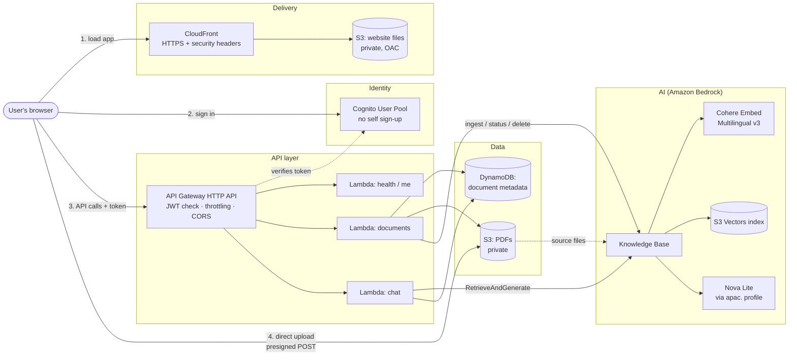
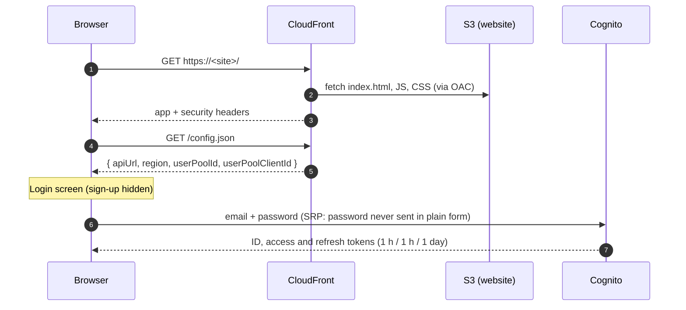
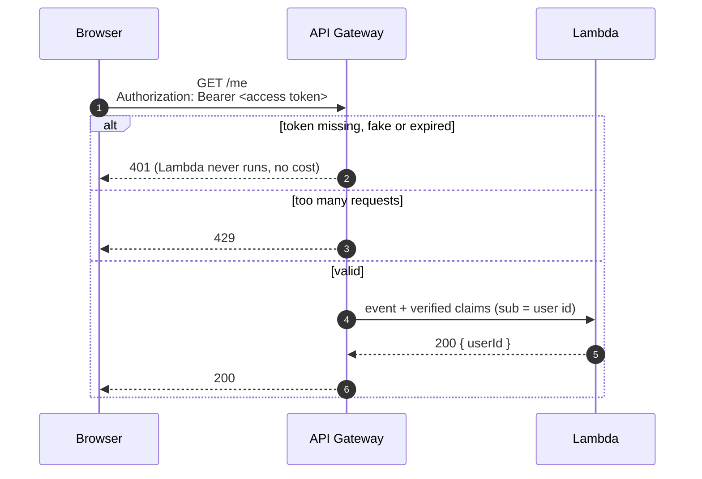
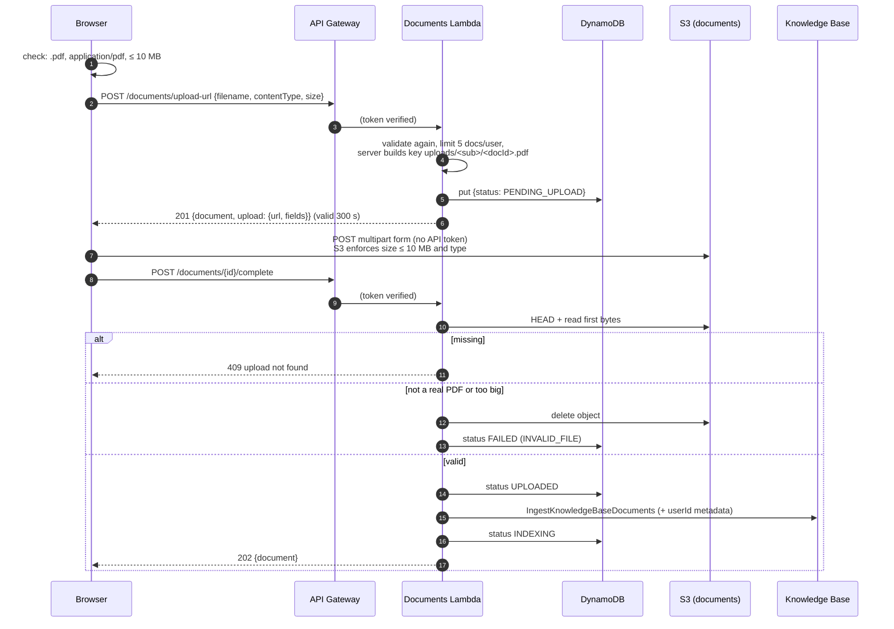
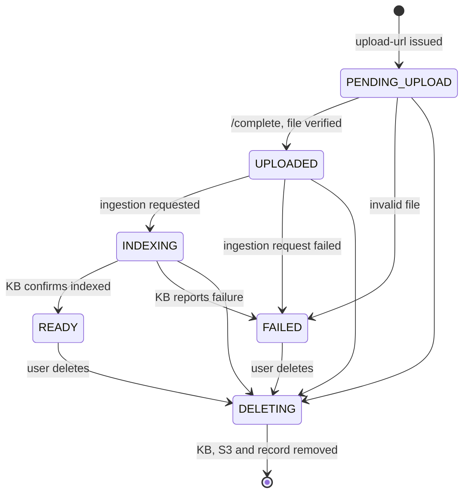
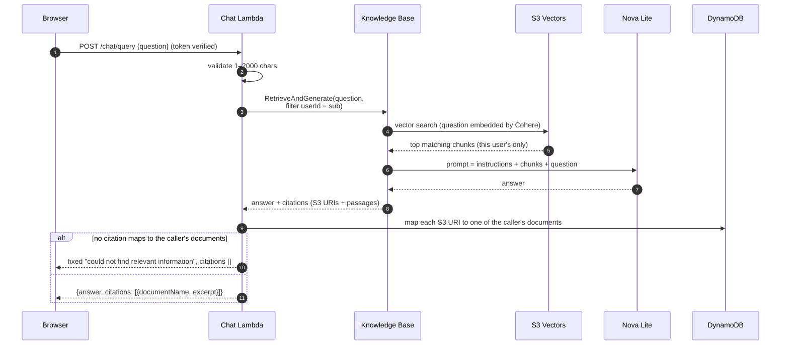
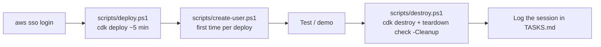

# How CloudDocs AI Works

A plain-language guide to the system: what each part does, how requests and data flow, and which stage each piece is in. Last updated: 2026-11-19.

- Detailed checklist: `TASKS.md`
- Why each choice was made: `DECISIONS.md` (D-001…D-013)
- API contract: `API_SPECIFICATION.md`

---

## 1. What it is

CloudDocs AI is a web app where a signed-in user uploads PDF files and asks questions about them. The answers are generated by an AI model **using only passages retrieved from the user's own documents**, and every answer shows its sources.

This technique is called **RAG (Retrieval-Augmented Generation)**:
1. Split each document into chunks, turn each chunk into a vector (a list of numbers that captures its meaning) and store the vectors.
2. When a question arrives, turn the question into a vector and find the most similar chunks. This is the *retrieval* step.
3. Give those chunks to a language model and ask it to answer from them. This is the *generation* step.

The model is **not trained** on your documents. It only reads the retrieved passages at question time.

Everything is **serverless**: there are no servers to manage, and you pay per request. It runs in **ap-southeast-1 (Singapore)**, and environments are **ephemeral**: deploy → demo → destroy (D-002).

---

## 2. Status at a glance

| Legend | Meaning |
|---|---|
| ✅ Live-tested | Deployed to AWS and verified, then torn down |
| 🧪 Code + tests | Logic exists with unit tests; AWS wiring not built yet |
| ⬜ Planned | Not started |

| Area | Status | Where |
|---|---|---|
| Login (Cognito, admin-created users only) | ✅ | `infrastructure/stacks/auth.py`, `frontend/src/auth.ts` |
| API Gateway with JWT check, throttling, CORS | ✅ | `infrastructure/stacks/api.py` |
| `GET /health`, `GET /me` Lambdas | ✅ | `backend/src/clouddocs/handlers/health.py`, `me.py` |
| Website on private S3 + CloudFront, security headers | ✅ | `infrastructure/stacks/web.py` |
| Deploy / destroy / teardown-check scripts | ✅ | `scripts/` |
| Upload, complete, list, delete logic | 🧪 | `backend/src/clouddocs/services/documents.py` |
| Chat logic and citation mapping | 🧪 | `backend/src/clouddocs/services/chat.py`, `rag.py` |
| Frontend upload, list, chat and real API client | 🧪 | `frontend/src/components/`, `frontend/src/api/http.ts` |
| Document bucket, DynamoDB table, boto3 adapters | ⬜ Phase 2 | — |
| Bedrock Knowledge Base + S3 Vectors | ⬜ Phase 3 (spike P0-07 first) | — |
| Grounded chat end to end | ⬜ Phase 4 | — |
| Visual design | ⬜ UI track | — |
| Alarms, IAM review, Guardrails | ⬜ Phase 5 | — |
| SQS/DLQ, CI/CD | ⬜ Phase 6 | — |

---

## 3. Architecture



Today the **Edge**, **Identity** and the **health/me** part of the **API layer** are live-tested ✅. The **documents** and **chat** Lambdas exist as code but are not deployed yet. **Data** and **AI** are built in Phases 2–4.

### Components

| Component | Job | Why this choice |
|---|---|---|
| **CloudFront** | Serves the React app over HTTPS worldwide and adds security headers (CSP, HSTS, frame-deny) | Fast, cheap, and keeps the S3 bucket private (D-009) |
| **S3 website bucket** | Stores the built React files | Readable **only** by this CloudFront distribution (Origin Access Control) |
| **Cognito User Pool** | Sign-in. Issues short-lived tokens (JWTs) | Self sign-up disabled, so strangers can't create accounts and run up costs (D-004) |
| **API Gateway (HTTP API)** | Public HTTPS entry point. **Checks the token before any code runs**, limits the request rate (5 rps, burst 10) and allows calls only from our website | Cheapest API type with built-in JWT checking |
| **Lambda functions** | Python 3.12 on ARM. Thin handlers call tested business logic | Pay per request, nothing idle |
| **S3 document bucket** | Stores PDFs at `uploads/<userId>/<documentId>.pdf` | The browser uploads directly with a short-lived signed form |
| **DynamoDB** | Document metadata and status, keyed by user | On-demand, near-zero cost at rest |
| **Bedrock Knowledge Base** | Parses and chunks PDFs, creates vectors, searches them and calls the model | Managed RAG instead of hand-building the pipeline (D-005, D-010) |
| **S3 Vectors** | Stores and searches the vectors | Pay per use, no idle cost (D-007) |
| **Cohere Embed Multilingual v3** | Turns text into vectors, English and Vietnamese | Available in Singapore; Titan isn't (D-008) |
| **Nova Lite** | Writes the answer from retrieved passages | Cheap, data stays in APAC. Claude is the fallback (D-008) |

---

## 4. The flows

### 4.1 Opening the app and signing in ✅



- `config.json` is written by CDK at **deploy time**, so the same build works for any deployment and no IDs live in git.
- First login with a temporary password forces a password change (12+ characters, upper case, lower case and a digit).

### 4.2 Every API call ✅



The **user identity always comes from the verified token's `sub` claim**, never from the request body. Every database key and S3 path is built from it, so one user can't reach another user's data.

### 4.3 Uploading a PDF 🧪 (code ready, AWS in Phase 2)



- **Presigned POST** (D-013): a short-lived signed form that lets the browser upload one file straight to S3. Its policy enforces the size and content type at S3 itself.
- **Checked twice:** the browser checks for user experience, and the server checks again because the browser can't be trusted. After upload, the server also checks the real file starts with `%PDF-`.

### 4.4 Indexing and status 🧪 (Phase 3)

The browser polls `GET /documents`. For any document in `INDEXING`, the Lambda asks the Knowledge Base for that document's status and updates DynamoDB. This is "poll on read", which needs no extra infrastructure. A document becomes `READY` **only** after the Knowledge Base confirms it is indexed.



Status changes are **conditional writes** (compare-and-set). Two requests racing can't both move a document, and a temporary Bedrock error leaves the status unchanged instead of marking it failed.

### 4.5 Asking a question 🧪 (Phase 4)



There are two layers of protection between users: the **retrieval filter** (`userId = sub`) and the **citation check** against the caller's own documents. **Citations are never invented**: only passages Bedrock actually returned are shown. Text inside documents is treated as data, so the prompt tells the model to ignore instructions found in documents.

### 4.6 Deleting a document 🧪 (Phase 5)

1. Mark the document `DELETING`.
2. `DeleteKnowledgeBaseDocuments` removes it from the index.
3. Check the index no longer has it. Until then, the API returns **202** and keeps the PDF.
4. Only then delete the S3 object and the DynamoDB record, and return **204**.

This order guarantees a "deleted" document can't still appear in answers.

---

## 5. Working stages (how a session runs)



- **Kept between sessions:** the `CDKToolkit` bootstrap stack (a few cents a month), the AWS Budget and your Identity Center login.
- **Deleted every session:** everything tagged `Project=CloudDocsAI`, including the user pool, so you create the app user again after each deploy.
- **Local work needs no AWS:** `npm run dev` uses an in-memory mock API, and all tests run offline.

---

## 6. Project stages (roadmap)

| Phase | Goal | Status |
|---|---|---|
| 0 Setup & validation | Secure account, budget, CLI, model checks, bootstrap, **Knowledge Base spike** | 🟡 Spike (P0-07) is next |
| 1 Secure skeleton | Login, protected API, hosted website, deploy/destroy | ✅ Done 2026-11-18 |
| 2 Secure upload | Document bucket, DynamoDB, adapters, real uploads | ⬜ |
| 3 RAG ingestion | Knowledge Base + S3 Vectors in CDK, per-document indexing | ⬜ |
| 4 Grounded chat | Filtered `RetrieveAndGenerate`, citations, evaluation set | ⬜ MVP complete here |
| UI track | Visual design in mock mode | ⬜ Any time, free |
| 5 Hardening | Delete flow live, IAM review, alarms, Guardrails/WAF decisions | ⬜ |
| 6 Advanced | SQS + DLQ ingestion, GitHub Actions CI, portfolio material | ⬜ |

---

## 7. Security summary

| Threat | Defence |
|---|---|
| Strangers using the app (and your Bedrock budget) | No self sign-up; JWT required on every route except `/health`; throttling |
| Stolen or forged tokens | Short token lifetimes; API Gateway verifies the signature, issuer and audience |
| Reading another user's data | User ID only from the verified token; keys and S3 paths built server-side; retrieval filter by user |
| Public file exposure | All buckets private; the website only through CloudFront OAC; documents only through short-lived presigned forms |
| Malicious uploads | Size and type enforced by the S3 policy; server checks the real size and the PDF header |
| Prompt injection in PDFs | Retrieved text treated as data; prompt tells the model to ignore embedded instructions; Guardrails evaluated in Phase 5 |
| Leaked AWS keys | Identity Center SSO with temporary credentials; no keys in code or git; the repository is public, so it is kept clean |
| Forgotten resources and bills | One stack, `cdk destroy`, teardown check, budget alerts |

---

## 8. Repository map

```text
CloudDocs-AI/
├── backend/src/clouddocs/
│   ├── handlers/      thin Lambda entry points: health, me, documents, chat
│   ├── services/      business logic: documents.py, chat.py, rag.py, interfaces.py (ports)
│   ├── models.py      typed requests/responses and statuses
│   ├── validators.py  input checks, server-side key building
│   └── status.py      document state machine
├── backend/tests/     pytest with in-memory fakes (no AWS)
├── frontend/src/
│   ├── config.ts      runtime config (/config.json or VITE_ vars in dev)
│   ├── auth.ts        Cognito via Amplify (login only)
│   ├── api/           HttpApi (real), MockApi (local), shared types
│   └── components/    DocumentList, Chat
├── infrastructure/
│   ├── app.py         CDK entry point (Region, tags)
│   ├── stacks/        auth.py, api.py, web.py, backend_code.py (Lambda bundling)
│   └── tests/         synth-time security and teardown checks
├── scripts/           deploy / destroy / check-teardown / create-user (PowerShell)
└── docs/              this guide, AWS account setup
```
