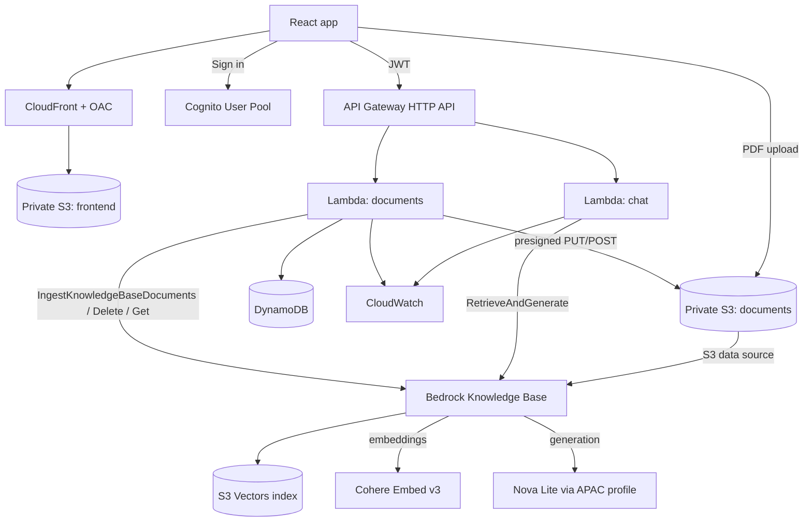

# CloudDocs AI — Architecture (Phase 0)

Status: **Phase 0 draft. Nothing is provisioned.** Region: `ap-southeast-1` (Singapore), chosen by the project owner.
Isolation model for MVP: **single-owner private workspace** (see §5).

Legend: ✅ verified from AWS docs on 2026-11-14 · ⚠️ unverified / must be re-checked against the live account before Phase 2.

## 1. Compatibility gate (ap-southeast-1)

| Capability | Finding | Status |
|---|---|---|
| S3 Vectors in ap-southeast-1 | Listed as a supported region. | ✅ |
| Knowledge Bases + S3 Vectors | Supported "in all regions where both Bedrock and S3 Vectors are available". Bedrock is available in Singapore (Nova/Cohere models listed there). | ✅ doc-level; ⚠️ confirm by creating a KB in Phase 2 |
| Titan Text Embeddings V2 (`amazon.titan-embed-text-v2:0`) | **Not** in the single-region list for ap-southeast-1, and no cross-region profile found. Do not plan on it. | ✅ (negative finding) |
| Cohere Embed English v3 (`cohere.embed-english-v3`) | In-region in ap-southeast-1, 1024 dims, float. Works with S3 Vectors (float only). | ✅ |
| Cohere Embed Multilingual v3 (`cohere.embed-multilingual-v3`) | In-region in ap-southeast-1, 1024 dims. | ✅ |
| Generation: Amazon Nova Lite/Micro/Pro | **Not in-region**; available through APAC cross-region inference profile, e.g. `apac.amazon.nova-lite-v1:0`. | ✅ (IDs inferred from doc format; confirm with `aws bedrock list-inference-profiles --region ap-southeast-1`) |
| Generation: Claude Haiku 5.5 | Only via a `global.` cross-region profile in Singapore. Exact profile ID not confirmed. | ⚠️ |
| Bedrock model access / account quotas | Per-account; cannot be checked from docs. | ⚠️ |
| Prices | Not verified; see `cost-estimate.md`. | ⚠️ |

Consequences:
- The spec's default idea of "Titan V2 embeddings" is replaced by **Cohere Embed v3**.
- Generation runs through a **cross-region inference profile**, so prompt and retrieved text may be processed in other regions (APAC for `apac.*`, anywhere for `global.*`). This must be stated in the README. Prefer `apac.*` if data locality matters.
- `RetrieveAndGenerate` must be given the inference profile ARN (not a bare model ID) for these models.

## 2. Recommended MVP stack

| Concern | Choice | Why |
|---|---|---|
| Frontend | React + TS + Vite on private S3 behind CloudFront (OAC) | Per spec; near-zero cost |
| Auth | Cognito User Pool, **self-signup disabled**, one admin-created user | Single-owner; removes abuse surface |
| API | API Gateway HTTP API + JWT authorizer, throttling set | Cheapest authenticated API |
| Backend | One Python 3.12 Lambda package, 2 handlers only if IAM differs (`documents`, `chat`) | Spec: avoid over-splitting |
| Metadata | DynamoDB on-demand, PK=`USER#id`, SK=`DOC#id` | As spec §7 |
| Vector store | **S3 Vectors** (float32, cosine) | No always-on cost, avoids OpenSearch Serverless minimum |
| Embeddings | `cohere.embed-multilingual-v3` (**decided**: PDFs are English and Vietnamese) | Only supported embedding family in-region; multilingual handles Vietnamese queries over English docs and vice versa |
| Generation | `apac.amazon.nova-lite-v1:0` initially | Cheap, APAC-bounded; swap to Claude via one config value |
| Chunking | Fixed-size (~300 tokens, 10–20% overlap) | Avoid hierarchical chunking: parent/child context is stored as non-filterable S3 Vectors metadata and can hit the 1 KB custom-metadata limit |
| IaC | Terraform | Per spec |

## 3. Architecture diagram

## 4. Ingestion strategy (key decision)

Two options exist for an S3 data source:

| | A. `StartIngestionJob` (full sync) | B. `IngestKnowledgeBaseDocuments` (direct ingestion, S3 location) |
|---|---|---|
| Granularity | Whole data source; scans all objects | Per document |
| Status | Job-level; cannot say a *given* file is READY | Per-document status via `GetKnowledgeBaseDocuments` ✅ |
| Concurrency | One job at a time; `ConflictException` risk | No sync job needed |
| Deletion | Re-sync after S3 delete | `DeleteKnowledgeBaseDocuments` |
| Caveat | — | Must **not** run at the same time as `StartIngestionJob`; first-time connection still needs one initial sync ✅ |

**Recommendation: B for the MVP**, with A kept only as an admin/manual recovery path (documented in the runbook, never run concurrently with B). This satisfies the spec rule that a document is not `READY` merely because a sync was requested.

Status lifecycle: `PENDING_UPLOAD → UPLOADED → INDEXING → READY | FAILED`, and `READY|FAILED → DELETING → (record removed)`.
- `POST /documents/{id}/complete`: HeadObject (verify existence, real size, `%PDF-` magic via ranged GET), conditional DynamoDB write (`PENDING_UPLOAD→UPLOADED`, idempotent), call `IngestKnowledgeBaseDocuments`, store status `INDEXING`.
- `GET /documents[/{id}]`: when `INDEXING`, the Lambda queries `GetKnowledgeBaseDocuments` and updates DynamoDB (poll-on-read; no extra infra). Phase 4 can move this to SQS + Step Functions.
- Delete: mark `DELETING`, `DeleteKnowledgeBaseDocuments`, verify absent, then delete S3 object and the DynamoDB item.
- ⚠️ To verify in Phase 2: exact request shape for S3 documents in direct ingestion, document-status enum values, and per-call limits.

## 5. Isolation decision

**MVP: single-owner workspace.** Public signup disabled; one Cognito user created by admin. All indexed content belongs to that owner, so a shared KB cannot leak across users.

Declared limitation: this is *not* multi-tenant. Authentication does not give per-document RAG authorization.

Upgrade path (documented, not built): attach `ownerId` as document metadata (`.metadata.json` / direct-ingestion metadata), pass a `retrievalConfiguration.vectorSearchConfiguration.filter` equal to the JWT `sub` on every `RetrieveAndGenerate`, and add an end-to-end test with two users proving no cross-retrieval. Alternative: one KB per user (more expensive). No isolation claim may be made without that test.

## 6. Security summary

- All buckets private + Block Public Access; frontend only via CloudFront OAC; HTTPS only.
- Presigned **POST** with policy conditions (content-length-range ≤ 10 MB, `application/pdf`, server-generated key `uploads/<userId>/<docId>.pdf`), 5-minute expiry. Chosen over PUT because PUT cannot enforce size.
- Owner ID always from JWT `sub` (authorizer context), never from the request body.
- Per-Lambda IAM: scoped to the specific bucket prefix, table, KB ARN, and inference-profile/model ARNs. Wildcards only where the API requires, with the reason documented.
- Prompt-injection stance: retrieved text is data; system prompt tells the model to answer only from retrieved passages and to say when evidence is missing. The "no citation without evidence" rule is enforced in code (return citations only from the Retrieve response).
- Logs: JSON with request ID; no document text or full prompts.
- Bedrock KB service role: least-privilege to the doc bucket, S3 Vectors index, and the embedding model.

## 7. Workflows

Upload → complete → index → query → delete follow spec §5 with the changes in §4 above. Chat: validate JWT and question length (≤ 2000 chars) → `RetrieveAndGenerate` (bounded retry with backoff on throttling) → normalise to `{answer, citations[], requestId}` where citations come from `citations[].retrievedReferences[]`; empty references means respond with uncertainty and no citations.

## 8. Risks and open assumptions

| # | Risk / assumption | Mitigation |
|---|---|---|
| R1 | Cohere/Nova model access not enabled on the account | Phase 2 pre-flight read-only checks, with user approval |
| R2 | Cross-region inference moves data outside Singapore | Use `apac.*`; document in README |
| R3 | Direct-ingestion API details unverified | Spike in Phase 2; fallback to sync job with a single-flight lock in DynamoDB |
| R4 | S3 Vectors 1 KB metadata limit breaks ingestion | Fixed-size chunking, no hierarchical chunking |
| R5 | Cost is not capped by Budgets | Budget alerts + teardown doc + tiny doc limits |
| R6 | PDFs with scanned images give poor text | Out of scope; documented |
| R7 | Pricing unverified | See `cost-estimate.md`; verify in AWS Pricing Calculator |

## 9. Open questions for the owner

1. ~~Document languages~~ **Answered:** English and Vietnamese, so Cohere Embed Multilingual v3. Follow-ups: Vietnamese answer quality of Nova Lite is unverified, so Phase 2 must include a Vietnamese Q&A test, with Claude Haiku as the fallback generation model. Vietnamese PDFs must have real text (not scans) and embedded Unicode fonts, or text extraction may be garbled.
2. Is cross-region inference (APAC) acceptable for your documents, or must everything stay in Singapore? If strictly in-region, the generation model options shrink.
